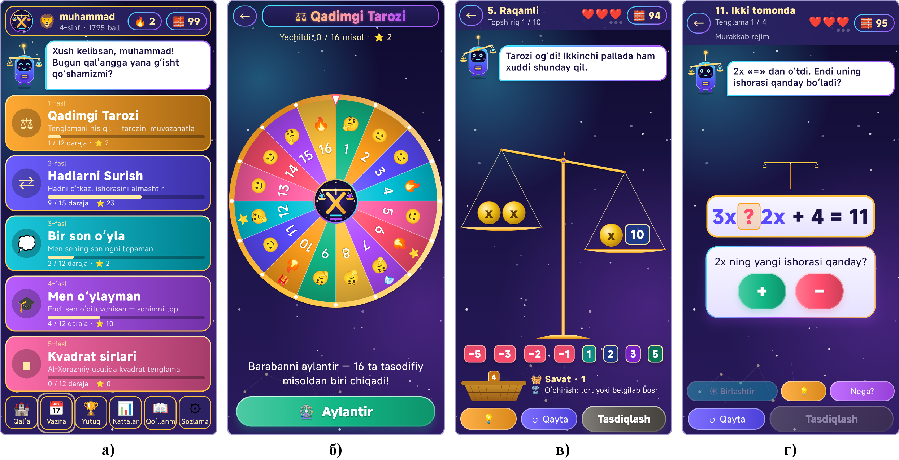
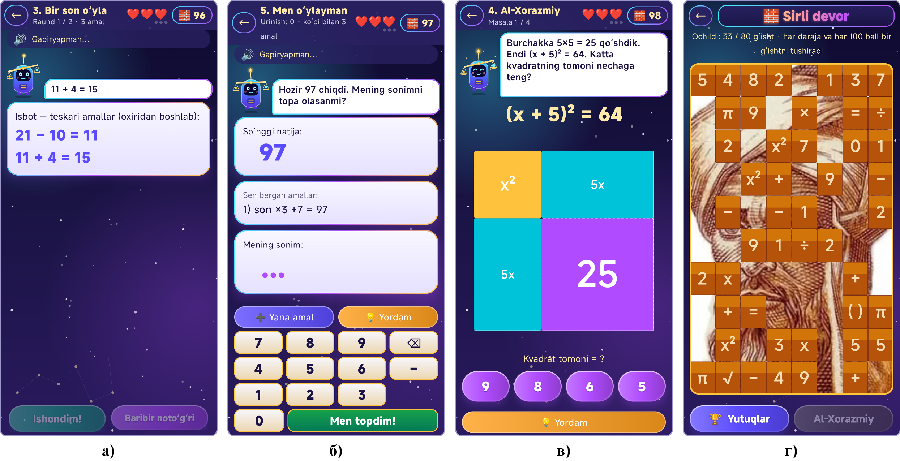
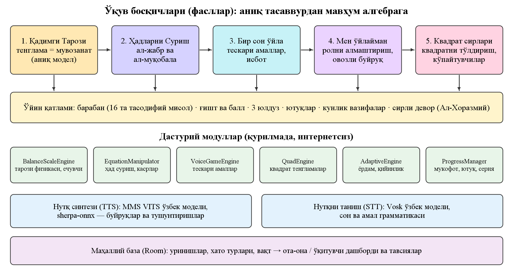

# ⚖️ Aljabr

**Algebra · Tenglamalar · 4–5-sinf · Android · o‘zbek tilida**

Tenglamani tarozi, Al-Xorazmiy usullari va «bir son o‘yla» o‘yini orqali tushuning — chiziqlidan kvadrat tenglamagacha.

## Ilova haqida

«Aljabr» — 4–5-sinf o‘quvchilarida chiziqli va kvadrat tenglamalarni yechish ko‘nikmasini o‘yin orqali shakllantiruvchi ilova. Bolaga tarozi-robot «Mezon» hamrohlik qiladi. Ilova aniq tasavvurdan mavhum yozuvga besh faslda olib o‘tadi: tarozi modeli, Al-Xorazmiyning «al-jabr» va «al-muqobala» amallari, «bir son o‘yla» o‘yini va kvadrat tenglamani Al-Xorazmiyning geometrik usulida yechish. Misollar har safar tasodifiy yaratiladi — yodlab bo‘lmaydi, tushunish kerak.

## Imkoniyatlar

- 5 fasl: Qadimgi tarozi → Hadlarni surish → Bir son o‘yla → Men o‘ylayman → Kvadrat sirlari
- 16 sektorli baraban, misollar har sessiyada tasodifiy generatsiya qilinadi
- Uch bosqichli yordam (skaffolding) va «Nega?» tugmasi
- Al-Xorazmiy kvadrati: (x + 5)² = 64 ni geometrik «to‘ldirish»
- «Sirli devor»: g‘ishtlar ortidan Al-Xorazmiy siymosi va ovozli hikoya ochiladi
- O‘zbekcha nutq sintezi va tanish internetsiz; ota-ona va o‘qituvchi dashbordi

## O‘yin ssenariysi

1. 1-fasl «Qadimgi tarozi» (12 daraja) — pallalarni muvozanatlash
2. 2-fasl «Hadlarni surish» (15 daraja) — ishora almashishini tushunish
3. 3–4-fasl «Bir son o‘yla» / «Men o‘ylayman» — teskari amallar
4. 5-fasl «Kvadrat sirlari» — kvadrat tenglama va ko‘paytuvchilarga ajratish

## 🏆 Natija

To‘rtta analog bilan ekspert taqqoslashida **35 balldan 31 ball — 1-o‘rin**.

## O‘rnatish

1. **[aljabr.apk](https://github.com/MSoqiy/aljabr/raw/main/apk/aljabr.apk)** faylini yuklab oling (APK papkasi — [apk/](https://github.com/MSoqiy/aljabr/tree/main/apk)).
2. Faylni oching; telefon so‘rasa, «Noma'lum manbalardan o‘rnatish»ga ruxsat bering.
3. «O‘rnatish»ni bosing.

## Ekranlar

## English

**Aljabr** — Equation-solving game for grades 4–5 based on the balance model and al-Khwarizmi's methods. Free, ad-free. Part of the «Ta'limiy o‘yinlar» collection by Mamasaidov M.A..

---

**Muallif:** Mamasaidov M.A. — Toshkent shahar Mirzo Ulug‘bek markazi o‘qituvchisi · Tetrasoft · ✉ soqiy65@gmail.com · 🌐 https://msoqiy.github.io · «[Ta'limiy o‘yinlar](https://msoqiy.github.io/oyinlar/)»

**Boshqa ilovalar:** [Otin buvi](https://github.com/MSoqiy/otin-buvi) · [Donish bobo](https://github.com/MSoqiy/donish-bobo) · [Bayon AI](https://github.com/MSoqiy/bayon-ai) · [Tilbilgich En AI](https://github.com/MSoqiy/tilbilgich-en) · [Tilbilgich Fr AI](https://github.com/MSoqiy/tilbilgich-fr) · [Tilbilgich De AI](https://github.com/MSoqiy/tilbilgich-de) · [Tilbilgich Ar AI](https://github.com/MSoqiy/tilbilgich-ar) · [GeoSayyoh](https://github.com/MSoqiy/geosayyoh) · [So‘zla](https://github.com/MSoqiy/sozla)

Kalit so‘zlar: tenglamalar yechish, algebra o‘yini, kvadrat tenglama, Al-Xorazmiy, 5-sinf matematika, tenglama bolalar uchun, matematika ilovasi, уравнения для школьников на узбекском, алгебра игра, o‘zbekcha ta'limiy o‘yin, android apk
